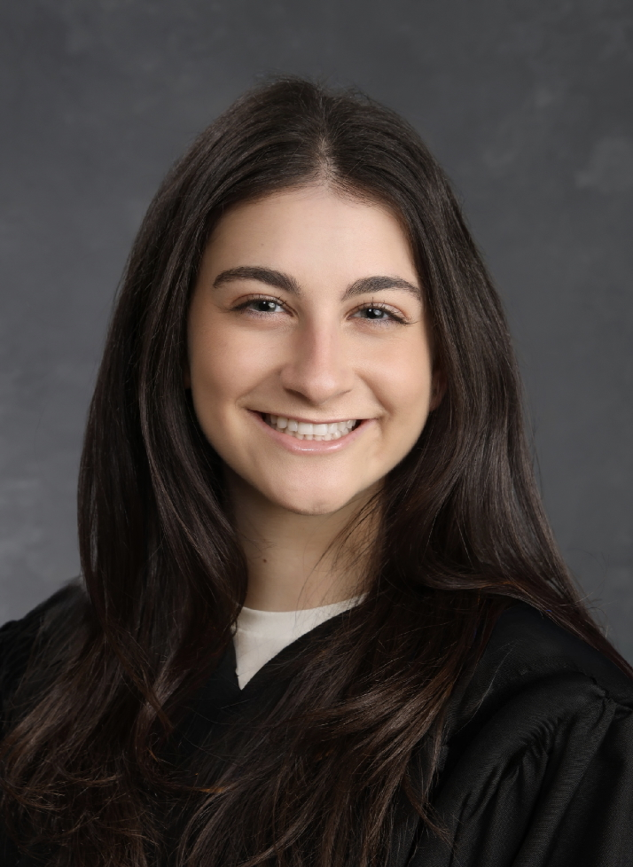

**MPH Candidate | Researcher | Aspiring Physician**

Welcome to my website. 

I am currently pursuing my Master of Public Health at Columbia University Mailman School of Public Health in the department of Population and Family Health with a certificate in Applied Biostatistics and Public Health Data Science. 

Before beginning my graduate studies, I earned my Bachelor of Health Sciences at Queen's University. There, I started to see health as something shaped not just in the clinic, but by where people live, work, and grow up. That shift brought me to public health. 

At Columbia, I've been building skills in statistical analysis and programming, which has deepened my interest in the intersection of clinical medicine, public health, and technology, particularly how AI and emerging tools can be brought into clinical practice in ways that improve patient care and advance health equity. 

I ultimately hope to pursue a career as a physician in academic medicine, combining clinical expertise, public health, and technological innovation to deliver better care at the individual, community, and global levels.

